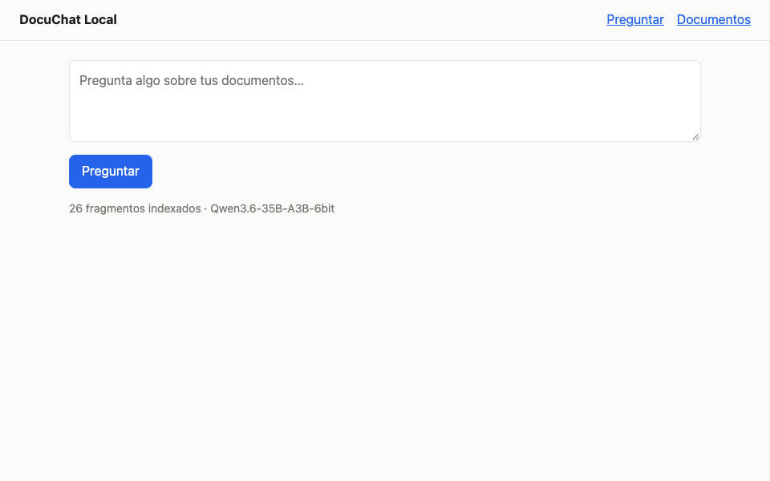

# DocuChat Local

[](https://github.com/Alvarito90s/RAG-Docs/actions/workflows/ci.yml)

**English** · [Español](README.md)

Ask questions about your documents without them ever leaving your computer. DocuChat answers with `[n]` citations that link to the exact page of the source document, and says "I don't know" when the answer isn't there.



## What it does

- Indexes PDF, DOCX, Markdown and TXT files from a folder. Indexing is incremental: only changed files are reprocessed.
- Hybrid search: vector (ChromaDB) and BM25, merged with Reciprocal Rank Fusion.
- Streamed answers with citations resolved to document and page; in the web UI, a citation opens the PDF at that page.
- CLI (`ingest`, `search`, `ask`, `serve`) and a web UI built with FastAPI and HTMX, no JavaScript framework.
- 100% local: models are served by oMLX on Apple Silicon. No LangChain, LlamaIndex or Haystack.

## How it works

```
documents ─► loaders ─► cleaning ─► chunks (800 chars, 120 overlap) ─┬─► embeddings ─► ChromaDB
                                                                     └─► BM25 (in memory)

question ─┬─► vector search ─┐
          └─► BM25 ──────────┴─► RRF (k=60) ─► top 5 ─► prompt ─► LLM (streaming)
                                                                    │
                                answer with [n] ─► document and page
```

| Component | Technology |
| --- | --- |
| LLM | `Qwen3.6-35B-A3B-6bit` via oMLX (OpenAI-compatible API) |
| Embeddings | `Qwen3-Embedding-0.6B-4bit-DWQ` (1024 dimensions) |
| Vectors | Persistent ChromaDB, cosine distance |
| Lexical | `rank-bm25` |
| Registry | SQLite (SHA-256 hash per document) |
| Web | FastAPI, Jinja2, HTMX, Server-Sent Events |

## Results

Evaluation with 42 questions over the 7 documents in `samples/`: 32 are answered on a specific page and 10 have no answer in the corpus. The dataset is in [`eval/questions.jsonl`](eval/questions.jsonl) and the full report in [`eval/results.md`](eval/results.md) (both in Spanish).

**Retrieval** (32 answerable questions; MRR over the top 10 results):

| Chunk | Mode | Chunks | Hit@1 | Hit@5 | MRR@10 | Misses (top 5) |
| ---: | --- | ---: | ---: | ---: | ---: | --- |
| 500 | hybrid | 45 | 0.844 | 1.000 | 0.917 | — |
| 500 | vector | 45 | 0.938 | 1.000 | 0.952 | — |
| 500 | bm25 | 45 | 0.844 | 1.000 | 0.898 | — |
| 800 | hybrid | 26 | 0.906 | 1.000 | 0.953 | — |
| 800 | vector | 26 | 0.938 | 1.000 | 0.958 | — |
| 800 | bm25 | 26 | 0.844 | 1.000 | 0.909 | — |
| 1200 | hybrid | 23 | 0.906 | 1.000 | 0.953 | — |
| 1200 | vector | 23 | 0.938 | 1.000 | 0.958 | — |
| 1200 | bm25 | 23 | 0.875 | 1.000 | 0.924 | — |

**Generation** (hybrid search, chunk size 800):

| Metric | Value |
| --- | ---: |
| Questions | 42 (32 answerable, 10 unanswerable) |
| Keyword accuracy | 1.000 |
| Citation precision | 0.971 |
| Correct refusals | 1.000 |
| False refusals | 0 |
| Time to first token (mean) | 0.57 s |
| Total time (mean) | 0.75 s |

How to read it:

- **Hit@5 is 1.000 in every configuration.** With such a small corpus the right page always reaches the context; what separates configurations is Hit@1 and MRR.
- **Vector search beats hybrid on this corpus.** Questions are in natural language and there are few documents. Hybrid stays the default with larger corpora and exact-code lookups (`SKU-4471-B`, `E-17`) in mind, but it doesn't help here; `eval/run_eval.py` lets you measure it on your own documents.
- **q17 was a false refusal, fixed in v1.0.1.** "How long is technical support free?" doesn't say which product it means, and the prompt's only rule for doubt was to answer "I don't know". The prompt now asks the model to answer for the specific case and say which one it is; at temperature 0, q17 is answered correctly on every run.
- **That's why citation precision is 0.971, not 1.000.** q17 also mentions the contract's 2-year warranty and cites it, which the evaluation counts as an unexpected page. All 10 unanswerable questions are still refused.

To rerun the evaluation (with oMLX running; it takes a few minutes):

```bash
uv run python eval/run_eval.py              # retrieval and generation
uv run python eval/run_eval.py --skip-llm   # retrieval only
```

## Requirements

- A Mac with Apple Silicon (oMLX uses MLX).
- [uv](https://docs.astral.sh/uv/) and Python 3.12.
- oMLX listening on `127.0.0.1:8000`, with an API key and these two models downloaded:
  - `Qwen3.6-35B-A3B-6bit`: the weights alone take about 27 GB of unified memory. Any chat model served by oMLX works by changing `DOCUCHAT_LLM_MODEL`.
  - `Qwen3-Embedding-0.6B-4bit-DWQ`.

## Getting started

```bash
git clone https://github.com/Alvarito90s/RAG-Docs.git
cd RAG-Docs
uv sync
cp .env.example .env                    # put your oMLX key in DOCUCHAT_LLM_API_KEY
uv run python scripts/check_env.py      # checks that oMLX answers with both models
uv run docuchat ingest                  # indexes samples/
uv run docuchat ask "¿Qué significa el error E-17 de la cafetera?"
uv run docuchat serve                   # http://127.0.0.1:8001
```

The sample documents and prompts are in Spanish, but questions and documents can be in any language the models handle. To use your own documents, set `DOCUCHAT_DOCUMENTS_DIR` or pass the folder to `ingest`.

## CLI

| Command | What it does |
| --- | --- |
| `docuchat ingest [FOLDER]` | Indexes the folder (incremental). `--reset` rebuilds the index from scratch; `--dry-run` only lists documents and pages. |
| `docuchat search "TEXT"` | Shows the most relevant chunks. `--mode hybrid\|vector\|bm25`, `-k N`. |
| `docuchat ask "QUESTION"` | Streams the answer and lists the cited sources. `-k N` context chunks. |
| `docuchat serve` | Starts the web UI at `http://127.0.0.1:8001`. `--host`, `--port`. |

## Web UI and API

The web UI has two pages: the chat (`/`) and the indexed documents, with a reindex button (`/documents`).

| Method | Path | What it does |
| --- | --- | --- |
| GET | `/api/health` | Status, number of documents and chunks, models |
| GET | `/api/documents` | Indexed documents |
| POST | `/api/search` | Search (`query`, `top_k`, `mode`) |
| POST | `/api/ask` | Answer over Server-Sent Events: `token`, `done` (with sources) or `error` |
| POST | `/api/ingest` | Starts a background indexing job (202) |
| GET | `/api/ingest/{job_id}` | Indexing job status |
| GET | `/files/{source}` | Serves the original document (citations link here with `#page=N`) |

## Docker

MLX needs Metal, so the models can't run inside a container. The image ships only the app and uses the Mac's oMLX through `host.docker.internal`.

```bash
docker compose up --build
```

- Open `http://127.0.0.1:8001` and click reindex under **Documentos**.
- `./samples` is mounted read-only at `/documents`. For your own documents, change that volume in [`compose.yaml`](compose.yaml).
- The index lives in the `docuchat-data` volume, so it survives restarts.
- The key is read from your `.env` at startup. It is never copied into the image: `.dockerignore` excludes it.

If the container can't reach oMLX, check the connection from inside:

```bash
docker compose exec docuchat python -c "from docuchat.env_check import main; raise SystemExit(main())"
```

## Configuration

Everything is configured with `DOCUCHAT_*` variables in `.env`; [`.env.example`](.env.example) has the full list with defaults. The most useful ones:

| Variable | Default | Purpose |
| --- | --- | --- |
| `DOCUCHAT_LLM_API_KEY` | (empty) | oMLX key |
| `DOCUCHAT_LLM_MODEL` | `Qwen3.6-35B-A3B-6bit` | Chat model |
| `DOCUCHAT_EMBEDDING_MODEL` | `Qwen3-Embedding-0.6B-4bit-DWQ` | Embedding model |
| `DOCUCHAT_DOCUMENTS_DIR` | `samples` | Documents folder |
| `DOCUCHAT_DATA_DIR` | `data` | Index (Chroma and SQLite registry) |
| `DOCUCHAT_CHUNK_SIZE` / `DOCUCHAT_CHUNK_OVERLAP` | `800` / `120` | Chunk size and overlap, in characters |
| `DOCUCHAT_TOP_K` | `5` | Chunks passed to the LLM |
| `DOCUCHAT_LLM_TEMPERATURE` | `0` | LLM randomness; 0 gives reproducible answers |
| `DOCUCHAT_LLM_THINKING` | `false` | Qwen reasoning mode (slower) |

If you change the embedding model, rebuild the index with `docuchat ingest --reset`: the app refuses to mix vectors from different models.

## Design decisions

- **No RAG frameworks.** Every piece (loaders, chunker, fusion, prompts, citations) is a small module you can read and test on its own.
- **800-character chunks with 120 overlap.** In the evaluation they tie with 1200 and beat 500 with hybrid search, while giving the LLM shorter passages.
- **Instruction on queries only.** Qwen3-Embedding recommends prefixing the query with an instruction; documents are indexed without it.
- **RRF with k=60 and no repeated neighbours.** Of two adjacent chunks from the same page only the best one is kept, so context isn't wasted on overlapping text.
- **Validated `[n]` citations.** Citations that don't match any retrieved chunk are dropped, with a warning.
- **Temperature 0 and a rule for ambiguous questions.** Answers are reproducible and, when a question doesn't say what it refers to, the model answers for the case it finds instead of saying "I don't know".
- **Reasoning off** for latency; turn it on with `DOCUCHAT_LLM_THINKING=true`.
- **Self-healing index.** If the SQLite registry and Chroma get out of sync, the next indexing run reprocesses what's missing.

## How it was built

The project was developed by two AI agents, with a human reviewing:

- A **brain** (Claude) writes one spec per task in [`tasks/`](tasks): goal, files, exact signatures and tests with expected values that can't be changed.
- An **executor** (Qwen 3.6 running locally, through opencode) implements each spec and writes a report in [`reports/`](reports). Its rules are in [`AGENTS.md`](AGENTS.md).
- The brain checks every report by running the suite and testing against the real models. When something is off, it writes a correction spec (the `NNN-b` ones).

Specs, reports and the project state ([`docs/STATE.md`](docs/STATE.md)) are written in Spanish.

## Development

```bash
uv run pytest -q
uv run ruff check . && uv run ruff format --check .
uv run mypy src
```

Tests never call oMLX: they use fake embedding and chat models. CI runs the same checks and also builds the Docker image.

```
src/docuchat/
  config.py      settings (pydantic-settings, DOCUCHAT_ prefix)
  ingest/        per-format loaders, cleaning and folder scanner
  index/         chunker, embeddings, Chroma, BM25, registry and indexer
  retrieval/     RRF fusion and hybrid searcher
  generation/    LLM client, prompts, citations and Answerer
  evaluation/    dataset, metrics, runner and report
  api/           FastAPI, templates and static files
  cli.py         ingest, search, ask and serve commands
```

## Limitations

- The models need a Mac with Apple Silicon. The app talks to any OpenAI-compatible server (`DOCUCHAT_LLM_BASE_URL`), but it has only been tested with oMLX.
- No OCR: scanned PDFs without a text layer aren't indexed.
- The BM25 index lives in memory and is rebuilt at startup: built for thousands of chunks, not millions.
- The evaluation uses a small, generated corpus (`scripts/make_samples.py`); the numbers don't generalise to every collection.

## License

[MIT](LICENSE)
