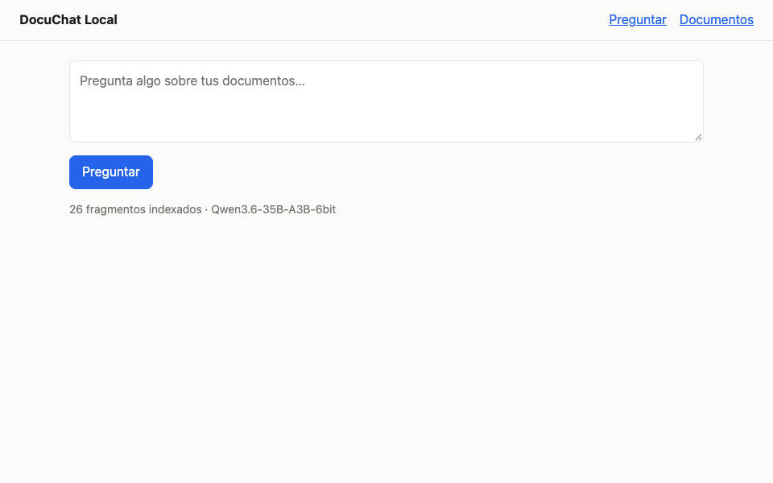

# DocuChat Local

[](https://github.com/Alvarito90s/RAG-Docs/actions/workflows/ci.yml)

Pregunta a tus documentos sin que salgan de tu ordenador. DocuChat responde con citas `[n]` que enlazan a la página exacta del documento, y dice "No lo sé" cuando la respuesta no está.



## Qué hace

- Indexa PDF, DOCX, Markdown y TXT de una carpeta. La indexación es incremental: solo reprocesa lo que ha cambiado.
- Búsqueda híbrida: vectorial (ChromaDB) y BM25, fusionadas con Reciprocal Rank Fusion.
- Respuestas en streaming con citas que se resuelven a documento y página; en la web, la cita abre el PDF en esa página.
- CLI (`ingest`, `search`, `ask`, `serve`) y web con FastAPI y HTMX, sin frameworks de JavaScript.
- 100 % local: los modelos los sirve oMLX en Apple Silicon. Sin LangChain, LlamaIndex ni Haystack.

## Cómo funciona

```
documentos ─► loaders ─► limpieza ─► chunks (800 car., 120 de solape) ─┬─► embeddings ─► ChromaDB
                                                                       └─► BM25 (en memoria)

pregunta ─┬─► búsqueda vectorial ─┐
          └─► BM25 ───────────────┴─► RRF (k=60) ─► top 5 ─► prompt ─► LLM (streaming)
                                                                         │
                                       respuesta con [n] ─► documento y página
```

| Pieza | Tecnología |
| --- | --- |
| LLM | `Qwen3.6-35B-A3B-6bit` vía oMLX (API compatible con OpenAI) |
| Embeddings | `Qwen3-Embedding-0.6B-4bit-DWQ` (1024 dimensiones) |
| Vectores | ChromaDB persistente, distancia coseno |
| Léxico | `rank-bm25` |
| Registro | SQLite (hash SHA-256 por documento) |
| Web | FastAPI, Jinja2, HTMX, Server-Sent Events |

## Resultados

Evaluación con 42 preguntas sobre los 7 documentos de `samples/`: 32 tienen respuesta en una página concreta y 10 no tienen respuesta. El dataset está en [`eval/questions.jsonl`](eval/questions.jsonl) y el informe completo en [`eval/results.md`](eval/results.md).

**Recuperación** (32 preguntas con respuesta; MRR sobre los 10 primeros resultados):

| Chunk | Modo | Chunks | Hit@1 | Hit@5 | MRR@10 | Fallos (top 5) |
| ---: | --- | ---: | ---: | ---: | ---: | --- |
| 500 | hybrid | 45 | 0.844 | 1.000 | 0.917 | — |
| 500 | vector | 45 | 0.938 | 1.000 | 0.952 | — |
| 500 | bm25 | 45 | 0.844 | 1.000 | 0.898 | — |
| 800 | hybrid | 26 | 0.906 | 1.000 | 0.953 | — |
| 800 | vector | 26 | 0.938 | 1.000 | 0.958 | — |
| 800 | bm25 | 26 | 0.844 | 1.000 | 0.909 | — |
| 1200 | hybrid | 23 | 0.906 | 1.000 | 0.953 | — |
| 1200 | vector | 23 | 0.938 | 1.000 | 0.958 | — |
| 1200 | bm25 | 23 | 0.875 | 1.000 | 0.924 | — |

**Generación** (búsqueda híbrida, chunk 800):

| Métrica | Valor |
| --- | ---: |
| Preguntas | 42 (32 con respuesta, 10 sin respuesta) |
| Palabras clave correctas | 0.969 |
| Precisión de citas | 1.000 |
| Rechazo correcto | 1.000 |
| Falsos rechazos | 1 |
| Primer token (media) | 0.47 s |
| Tiempo total (media) | 0.62 s |

Cómo leerlo:

- **Hit@5 es 1.000 en todas las configuraciones.** Con un corpus tan pequeño, la página correcta siempre llega al contexto; lo que separa las configuraciones es Hit@1 y MRR.
- **La búsqueda vectorial gana a la híbrida en este corpus.** Las preguntas están en lenguaje natural y hay pocos documentos. La híbrida queda por defecto pensando en corpus más grandes y en búsquedas por códigos exactos (`SKU-4471-B`, `E-17`), pero aquí no aporta; con `eval/run_eval.py` puedes medirlo con tus propios documentos.
- **Fallo conocido: q17** ("¿Durante cuánto tiempo es gratuito el soporte técnico?"). La página correcta del manual se recupera, pero el modelo responde "No lo sé".
- Todas las citas apuntan al documento y la página esperados, y las 10 preguntas sin respuesta se rechazan.

Para repetir la evaluación (con oMLX arrancado; tarda unos minutos):

```bash
uv run python eval/run_eval.py              # recuperación y generación
uv run python eval/run_eval.py --skip-llm   # solo recuperación
```

## Requisitos

- Mac con Apple Silicon (oMLX usa MLX).
- [uv](https://docs.astral.sh/uv/) y Python 3.12.
- oMLX escuchando en `127.0.0.1:8000`, con API key y estos dos modelos descargados:
  - `Qwen3.6-35B-A3B-6bit`: solo los pesos ocupan unos 27 GB de memoria unificada. Cualquier modelo de chat que sirva oMLX vale cambiando `DOCUCHAT_LLM_MODEL`.
  - `Qwen3-Embedding-0.6B-4bit-DWQ`.

## Puesta en marcha

```bash
git clone https://github.com/Alvarito90s/RAG-Docs.git
cd RAG-Docs
uv sync
cp .env.example .env                    # pon tu clave de oMLX en DOCUCHAT_LLM_API_KEY
uv run python scripts/check_env.py      # comprueba que oMLX responde con los dos modelos
uv run docuchat ingest                  # indexa samples/
uv run docuchat ask "¿Qué significa el error E-17 de la cafetera?"
uv run docuchat serve                   # http://127.0.0.1:8001
```

Para usar tus documentos, pon la carpeta en `DOCUCHAT_DOCUMENTS_DIR` o pásala a `ingest`.

## CLI

| Comando | Qué hace |
| --- | --- |
| `docuchat ingest [CARPETA]` | Indexa la carpeta (incremental). `--reset` reconstruye el índice desde cero; `--dry-run` solo lista documentos y páginas. |
| `docuchat search "TEXTO"` | Muestra los fragmentos más relevantes. `--mode hybrid\|vector\|bm25`, `-k N`. |
| `docuchat ask "PREGUNTA"` | Responde en streaming y lista las fuentes citadas. `-k N` fragmentos de contexto. |
| `docuchat serve` | Arranca la web en `http://127.0.0.1:8001`. `--host`, `--port`. |

## Web y API

La web tiene dos páginas: el chat (`/`) y los documentos indexados con un botón para reindexar (`/documents`).

| Método | Ruta | Qué hace |
| --- | --- | --- |
| GET | `/api/health` | Estado, número de documentos y chunks, modelos |
| GET | `/api/documents` | Documentos indexados |
| POST | `/api/search` | Búsqueda (`query`, `top_k`, `mode`) |
| POST | `/api/ask` | Respuesta por Server-Sent Events: `token`, `done` (con las fuentes) o `error` |
| POST | `/api/ingest` | Lanza una indexación en segundo plano (202) |
| GET | `/api/ingest/{job_id}` | Estado de la indexación |
| GET | `/files/{source}` | Sirve el documento original (las citas enlazan aquí con `#page=N`) |

## Docker

MLX necesita Metal, así que los modelos no pueden ir dentro de un contenedor. La imagen lleva solo la app y usa el oMLX del Mac a través de `host.docker.internal`.

```bash
docker compose up --build
```

- Abre `http://127.0.0.1:8001` y pulsa reindexar en **Documentos**.
- La carpeta `./samples` se monta en `/documents` en solo lectura. Para tus documentos, cambia ese volumen en [`compose.yaml`](compose.yaml).
- El índice vive en el volumen `docuchat-data`, así que sobrevive a reinicios.
- La clave se lee de tu `.env` al arrancar. Nunca se copia a la imagen: `.dockerignore` la excluye.

Si el contenedor no llega a oMLX, comprueba la conexión desde dentro:

```bash
docker compose exec docuchat python -c "from docuchat.env_check import main; raise SystemExit(main())"
```

## Configuración

Todo se configura con variables `DOCUCHAT_*` en `.env`; [`.env.example`](.env.example) tiene la lista completa con sus valores por defecto. Las más útiles:

| Variable | Por defecto | Para qué |
| --- | --- | --- |
| `DOCUCHAT_LLM_API_KEY` | (vacía) | Clave de oMLX |
| `DOCUCHAT_LLM_MODEL` | `Qwen3.6-35B-A3B-6bit` | Modelo de chat |
| `DOCUCHAT_EMBEDDING_MODEL` | `Qwen3-Embedding-0.6B-4bit-DWQ` | Modelo de embeddings |
| `DOCUCHAT_DOCUMENTS_DIR` | `samples` | Carpeta de documentos |
| `DOCUCHAT_DATA_DIR` | `data` | Índice (Chroma y registro SQLite) |
| `DOCUCHAT_CHUNK_SIZE` / `DOCUCHAT_CHUNK_OVERLAP` | `800` / `120` | Tamaño y solape de los chunks, en caracteres |
| `DOCUCHAT_TOP_K` | `5` | Fragmentos que se pasan al LLM |
| `DOCUCHAT_LLM_THINKING` | `false` | Razonamiento de Qwen (más lento) |

Si cambias el modelo de embeddings, reconstruye el índice con `docuchat ingest --reset`: la app se niega a mezclar vectores de modelos distintos.

## Decisiones de diseño

- **Sin frameworks de RAG.** Cada pieza (loaders, chunker, fusión, prompts, citas) es un módulo pequeño que se lee y se prueba por separado.
- **Chunks de 800 caracteres con 120 de solape.** En la evaluación empatan con 1200 y superan a 500 con búsqueda híbrida, y dan al LLM fragmentos más cortos.
- **Instrucción solo en las consultas.** Qwen3-Embedding recomienda prefijar la pregunta con una instrucción; los documentos se indexan sin ella.
- **RRF con k=60 y sin vecinos repetidos.** De dos chunks adyacentes de la misma página solo queda el mejor, para no gastar contexto en texto solapado.
- **Citas `[n]` validadas.** Las que no corresponden a ningún fragmento se descartan y se avisa.
- **Razonamiento desactivado** por latencia; se activa con `DOCUCHAT_LLM_THINKING=true`.
- **Índice que se repara solo.** Si el registro SQLite y Chroma se desincronizan, la siguiente indexación reprocesa lo que falta.

## Cómo se ha construido

El proyecto se ha desarrollado con dos agentes y un humano que revisa:

- Un **cerebro** (Claude) escribe una spec por tarea en [`tasks/`](tasks): objetivo, archivos, firmas exactas y tests con valores esperados que no se pueden cambiar.
- Un **ejecutor** (Qwen 3.6 en local, con opencode) implementa cada spec y deja un informe en [`reports/`](reports). Sus reglas están en [`AGENTS.md`](AGENTS.md).
- El cerebro verifica cada informe ejecutando la suite y probando contra los modelos reales. Si algo no cuadra, escribe una spec de corrección (las `NNN-b`).

El estado del proyecto se mantiene en [`docs/STATE.md`](docs/STATE.md).

## Desarrollo

```bash
uv run pytest -q
uv run ruff check . && uv run ruff format --check .
uv run mypy src
```

Los tests no llaman a oMLX: usan embeddings y modelos de chat falsos. La CI ejecuta lo mismo y además construye la imagen Docker.

```
src/docuchat/
  config.py      configuración (pydantic-settings, prefijo DOCUCHAT_)
  ingest/        loaders por formato, limpieza y escáner de carpetas
  index/         chunker, embeddings, Chroma, BM25, registro e indexador
  retrieval/     fusión RRF y buscador híbrido
  generation/    cliente LLM, prompts, citas y Answerer
  evaluation/    dataset, métricas, ejecución e informe
  api/           FastAPI, plantillas y estáticos
  cli.py         comandos ingest, search, ask y serve
```

## Limitaciones

- Los modelos necesitan un Mac con Apple Silicon. La app habla con cualquier servidor compatible con la API de OpenAI (`DOCUCHAT_LLM_BASE_URL`), pero solo se ha probado con oMLX.
- No hay OCR: los PDF escaneados sin capa de texto no se indexan.
- El índice BM25 vive en memoria y se reconstruye al arrancar: pensado para miles de chunks, no para millones.
- La evaluación usa un corpus pequeño y generado (`scripts/make_samples.py`); los números no se pueden extrapolar a cualquier colección.

## Licencia

[MIT](LICENSE)
